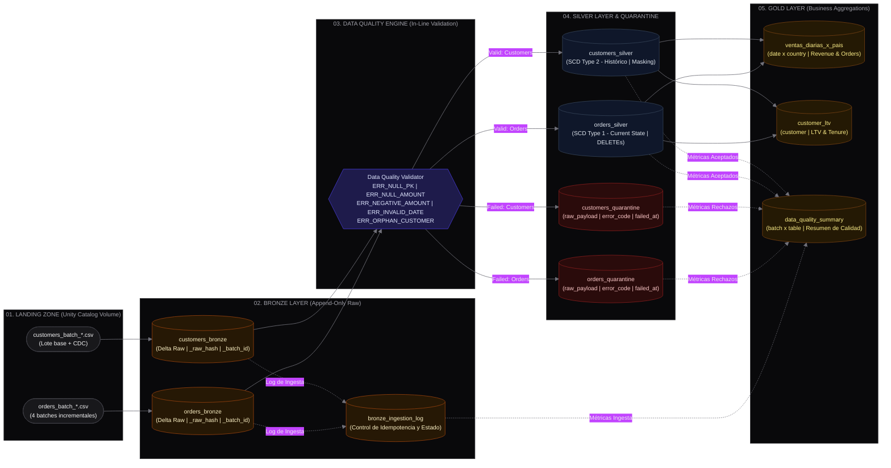

# Lakehouse Medallion Pipeline — Chubb Regional Data Engineering 2026

**Runtime**: Databricks Runtime 14.x+ | Unity Catalog | Apache Spark 3.5+ (Photon)  
**Catálogo Objetivo**: `chubb_lakehouse` | **Esquema**: `chubb_lakehouse`  
**Entrega**: Repositorio GitHub invitado a `emperor-swabs-5t@icloud.com` | Paquete comprimido `Prueba_DE_Regional_2026.zip`

Solución de ingeniería de datos para la **Prueba Técnica de Data Engineering Regional 2026 (Chubb)**. Implementa un Lakehouse Medallion reentrante e idempotente sobre **Databricks con Unity Catalog**, procesando clientes y órdenes con historización SCD Tipo 2, transacciones SCD Tipo 1, aislamiento de anomalías en cuarentena activa y agregaciones analíticas Gold para FinOps y toma de decisiones.

---

## 1. Arquitectura Medallion y Flujo de Datos



### Jerarquía de Tablas en Unity Catalog

| Capa | Nombre Canónico de Tabla | Esquema Unity Catalog | Tipo Delta / Patrón | Propósito y Semántica |
|---|---|---|---|---|
| **Landing** | `raw_landing` | `/Volumes/chubb_lakehouse/chubb_lakehouse/raw_landing` | UC Volume | Recepción batch cruda de archivos CSV/JSON (`orders_batch_*.csv`, `customers_batch_*.csv`) |
| **Bronze** | `customers_bronze` | `chubb_lakehouse.chubb_lakehouse.customers_bronze` | Append-Only | Ingesta inmutable de clientes con `_raw_hash`, `_ingested_at`, `_batch_id`, `_source_file` |
| **Bronze** | `orders_bronze` | `chubb_lakehouse.chubb_lakehouse.orders_bronze` | Append-Only | Ingesta inmutable de transacciones con `_raw_hash`, `_batch_id`, `_source_file` |
| **Bronze Audit** | `bronze_ingestion_log` | `chubb_lakehouse.chubb_lakehouse.bronze_ingestion_log` | Delta Table | Trazabilidad por archivo/batch (`file_path`, `batch_id`, `rows_read`, `rows_inserted`, `status = 'SUCCESS'`) para control de idempotencia |
| **Cuarentena** | `customers_quarantine` | `chubb_lakehouse.chubb_lakehouse.customers_quarantine` | Dead-Letter Queue | Almacena clientes anómalos con `raw_payload` (string serializado), `error_code`, `rejection_reason` y timestamp |
| **Cuarentena** | `orders_quarantine` | `chubb_lakehouse.chubb_lakehouse.orders_quarantine` | Dead-Letter Queue | Almacena órdenes anómalas (nulos PK/monto, negativos, fechas inválidas, huérfanos) con `raw_payload` intacto |
| **Silver** | `customers_silver` | `chubb_lakehouse.chubb_lakehouse.customers_silver` | SCD Tipo 2 | Dimensión histórica de clientes (`is_current`, `valid_from`, `valid_to`, `_change_hash`) con enmascaramiento dinámico PII |
| **Silver** | `orders_silver` | `chubb_lakehouse.chubb_lakehouse.orders_silver` | SCD Tipo 1 | Estado actual de órdenes, deduplicación intra-batch, aplicación de DELETEs lógicos/físicos y FK validada |
| **Gold** | `ventas_diarias_x_pais` | `chubb_lakehouse.chubb_lakehouse.ventas_diarias_x_pais` | Dimensional Agg | Granularidad `date x country`: ventas totales, volumen de órdenes, ticket promedio |
| **Gold** | `customer_ltv` | `chubb_lakehouse.chubb_lakehouse.customer_ltv` | Dimensional Agg | Granularidad `customer`: Customer Lifetime Value, recencia, frecuencia, tenencia y segmento |
| **Gold** | `data_quality_summary` | `chubb_lakehouse.chubb_lakehouse.data_quality_summary` | Observabilidad DQ | Granularidad `batch x table`: filas procesadas, aceptadas, rechazadas por código de error y tasa de calidad |

> **Nota de compatibilidad**: Los DDLs y vistas unificadas del proyecto (`src/setup/ddl/init_tables.py`) garantizan que las tablas sean accesibles tanto directamente bajo el esquema principal `chubb_lakehouse.chubb_lakehouse.<tabla>` como mediante la notación multi-esquema `chubb_lakehouse.<layer>.<tabla>`.

---

### 1.1 Especificaciones de Datos Sintéticos y Defectos Controlados

El módulo generador (`src/setup/generator/data_generator.py`) produce datasets deterministas y reproducibles (seed = 42) que modelan fielmente un entorno de retail multirregional:

* **Clientes Base**: ~5,000 registros (`customer_id, name, email, country, segment, updated_at`).
  - Países representados: Chile (`CL`), México (`MX`), Colombia (`CO`), Brasil (`BR`).
  - Segmentos de retail: `lifestyle`, `electronics`, `miscellaneous`, `CPG`.
* **Órdenes Base**: ~10,000 registros (`order_id, customer_id, order_ts, amount, currency, status, updated_at`).
  - Estados transaccionales: `PENDING`, `COMPLETED`, `SHIPPED`, `CANCELLED`.
* **Procesamiento Incremental**: 4 batches (`batch_01` a `batch_04`):
  - 3 batches de órdenes (`batch_01`, `batch_02`, `batch_03`) y 1 batch de clientes con updates CDC.
  - Columna de evento `transaction_type` con valores `INSERT`, `UPDATE` y `DELETE`.
* **6 Defectos Controlados Inyectados**:
  1. **Valores nulos en llaves o montos (~2%)**: `customer_id` nulo, `order_id` nulo o `amount` nulo. Se aíslan en cuarentena (`ERR_NULL_PK`, `ERR_NULL_AMOUNT`).
  2. **Nulos en campos opcionales (~2%)**: `email` o `segment` con valor nulo. **Tratados con valores por defecto (`'unassigned'`, `NULL` preservado) sin desvío a cuarentena**, permitiendo su procesamiento normal en Silver.
  3. **Duplicados exactos intra-batch**: Mismos valores en el mismo lote generador. Deduplicados deterministamente en la transformación Silver tomando el registro con mayor `updated_at`.
  4. **Llaves primarias duplicadas inter-batch**: Mismo `order_id` en distintos lotes con `updated_at` más reciente. Procesados correctamente vía CDC/SCD1 (actualización in-place sin duplicación de filas).
  5. **Órdenes Huérfanas**: `order_id` con `customer_id` inexistente o referenciando claves nulas. Identificados mediante validación referencial contra la dimensión de clientes y desviados a cuarentena (`ERR_ORPHAN_CUSTOMER`).
  6. **Valores Inválidos de Dominio y Formato**: Montos negativos o cero (`amount <= 0.0` ➔ `ERR_NEGATIVE_AMOUNT`), y fechas malformadas o ilegibles (`order_ts` ➔ `ERR_INVALID_DATE`).

---

### Estructura del Repositorio

```text
Prueba_Tecnica/
├── resources/
│   └── chubb_lakehouse_job.json        # Definición del Databricks Workflow Job
├── src/
│   ├── bronze/                         # Ingesta Bronze incremental & deduplicación
│   ├── gold/                           # Modelado dimensional & observabilidad DQ
│   ├── setup/                          # Aprovisionamiento único (One-Time Setup / Bootstrap)
│   │   ├── ddl/                        # DDLs y resolución de esquemas/tablas Delta
│   │   │   ├── init_tables.py          # SSOT de estructuras y DDLs ejecutables
│   │   │   ├── create_tables.sql       # Script DDL declarativo de tablas Delta
│   │   │   └── setup_catalog.sql       # Script DDL de catálogo, esquemas y volúmenes
│   │   └── generator/                  # Generador determinista de datos sintéticos
│   │       └── data_generator.py       # Inyección controlada de defectos (6 anomalías)
│   ├── silver/                         # Data Quality, cuarentena, SCD1 y SCD2
│   ├── tests/                          # Suite de pruebas unitarias deterministas
│   │   └── unit/                       # Tests unitarios sin mocks cosméticos
│   └── workflows/                      # Notebooks ejecutables del pipeline
│       ├── 00_setup_and_seed.py        # Bootstrap interactivo (Setup + Seed)
│       ├── 01_bronze_workflow.py       # Tarea 1: Ingesta Bronze
│       ├── 02_silver_workflow.py       # Tarea 2: Calidad & Silver
│       └── 03_gold_workflow.py         # Tarea 3: Agregaciones Gold
├── tests/
│   └── harness/fast_lint.py            # Static AST/SQL linter de alta velocidad
├── databricks.yml                      # Databricks Asset Bundle (DAB)
└── package_solution.py                 # Empaquetado limpio para entrega
```

---

## 2. Pasos de Ejecución

El ciclo de vida del pipeline se divide en dos fases claramente diferenciadas:

### Fase 1: Inicialización Única (One-Time Setup / Bootstrap)
`00_setup_and_seed.py` es un notebook de **inicialización única** que orquesta los componentes bajo `src/setup/`: aprovisiona el catálogo, esquemas, volúmenes de Unity Catalog y DDLs de tablas Delta (vía `src/setup/ddl/`), y genera los datos sintéticos de prueba (vía `src/setup/generator/`). **NO forma parte del Job recurrente de producción**.

```bash
# Ejecución interactiva en Databricks o vía CLI (se ejecuta 1 sola vez al inicializar el ambiente)
python src/workflows/00_setup_and_seed.py --catalog chubb_lakehouse --schema chubb_lakehouse --generate_data true
```

### Fase 2: Pipeline Recurrente en Databricks Workflows (Job de Producción)
El Job automatizado de producción (`resources/chubb_lakehouse_job.json`) orquesta exclusivamente el flujo de datos recurrente de las 3 capas Medallion:

```
01_bronze_workflow.py   ──►   02_silver_workflow.py   ──►   03_gold_workflow.py
 (bronze_ingest)               (silver_transform)             (gold_aggregate)
```

1. En la consola de Databricks, diríjase a **Workflows** > **Jobs** > **Create Job**.
2. Seleccione **Edit as JSON** e importe el contenido de `resources/chubb_lakehouse_job.json`.
3. Parámetros configurables a nivel de Job:
   - `catalog`: Catálogo de Unity Catalog (default: `chubb_lakehouse`).
   - `schema`: Esquema de la solución (default: `chubb_lakehouse`).
   - `volume_path`: Ruta al volumen landing (default: `/Volumes/chubb_lakehouse/chubb_lakehouse/raw_landing`).
   - `batch_id`: Identificador opcional del lote (autodetectado si se omite).
4. Ejecute el Job con **Run Now**. Las 3 tareas se ejecutarán en estricto orden de dependencias (`bronze_ingest` -> `silver_transform` -> `gold_aggregate`).

---

## 3. Data Quality Gates & Observabilidad en Runtime

La validación de calidad de datos está **100% integrada de forma nativa en el pipeline de datos (in-line en Spark durante la capa Silver)**, ejecutándose automáticamente en cada corrida sin requerir herramientas ni dependencias externas:

- **Validación Fila por Fila**: Durante la transformación de Bronze a Silver (`src/silver/quality.py` / `src/silver/rules.py`), cada registro se evalúa rigurosamente contra las reglas de completitud, validez de dominio, formato e integridad referencial.
- **Aislamiento en Cuarentena Activa**: Las filas inválidas se aíslan automáticamente en tablas de cuarentena (`orders_quarantine`, `customers_quarantine`) preservando el registro original intacto serializado en `raw_payload STRING`, junto con su `error_code`, motivo detallado (`rejection_reason`), timestamp (`failed_at`) y `_batch_id`.
- **Tratamiento Diferenciado de Nulos Opcionales**: Los campos opcionales (`email`, `segment`) con valores nulos no son catalogados como fallos críticos; se normalizan con valores por defecto (`'unassigned'`, `NULL` preservado) y se integran limpiamente a Silver.
- **Procesamiento No Bloqueante**: Las filas válidas continúan hacia las tablas dimensionales y transaccionales de la capa Silver (`customers_silver`, `orders_silver`).
- **Observabilidad Consolidada en Gold**: Los resultados de calidad y métricas de error se consolidan de manera automática en la tabla Gold `data_quality_summary` para trazabilidad y monitoreo continuo.

### Reglas de Calidad Validadas en el Pipeline

| Dimensión | Regla Lógica / Condición | Código Error | Entidad / Campo | Severidad | Tratamiento en Pipeline |
|---|---|---|---|---|---|
| **Completitud** | Clave primaria presente y no vacía (`IS NOT NULL AND TRIM != ''`) | `ERR_NULL_PK` | Clientes (`customer_id`), Órdenes (`order_id`) | **CRITICAL** | Desvío a cuarentena con `raw_payload` original en string |
| **Completitud** | Monto numérico no nulo y parseable (`amount IS NOT NULL`) | `ERR_NULL_AMOUNT` | Órdenes (`amount`) | **CRITICAL** | Desvío a cuarentena con `raw_payload` original en string |
| **Validez Dominio** | Monto estrictamente positivo (`amount > 0.0`) | `ERR_NEGATIVE_AMOUNT` | Órdenes (`amount`) | **CRITICAL** | Desvío a cuarentena con `raw_payload` original en string |
| **Validez Formato** | Parseo de timestamp / formato ISO válido (`to_timestamp(order_ts) IS NOT NULL`) | `ERR_INVALID_DATE` | Órdenes (`order_ts`) | **HIGH** | Desvío a cuarentena con `raw_payload` original en string |
| **Integridad Ref.** | Existencia de `customer_id` en dimensión activa de clientes | `ERR_ORPHAN_CUSTOMER` | Órdenes (`customer_id`) | **HIGH** | Desvío a cuarentena con `raw_payload` original en string |
| **Completitud Opc.**| Correo o segmento ausente o nulo | *N/A (Permitido)* | Clientes (`email`, `segment`) | **LOW** | **Preservado en Silver**: asignación de defaults (`'unassigned'`) sin cuarentena |

---

## 4. Estrategia de Idempotencia y Procesamiento Incremental

El pipeline garantiza matemáticamente que re-ejecutar cualquier paso o lote $N$ veces produce exactamente el mismo estado final en las tablas Delta, sin duplicaciones ni inconsistencias:

```
Lote Entrante ──► Hash determinista xxhash64(_raw_hash / _record_hash)
                         │
      ┌──────────────────┴──────────────────┐
      ▼                                     ▼
¿Existe en Destino?                   ¿Existe en Destino?
   [NO EXISTE]                          [YA EXISTE]
      │                                     │
 INSERT en Delta                     ¿_record_hash idéntico?
                                     ┌──────┴──────┐
                                    SI             NO
                                    │              │
                                NO-OP (0 rows)   UPDATE / Nuevo SCD2
```

1. **Bronze (Control por Archivo y Hash Incremental)**:
   - Seguimiento estricto en `bronze_ingestion_log`: antes de escribir, se verifica si el archivo ya fue procesado con `status = 'SUCCESS'`.
   - Se procesan **únicamente archivos nuevos** no registrados previamente. Re-ejecutar sobre la misma carpeta de landing es un **NO-OP estricto** (cero reingestas).
   - Cada registro conserva su huella digital `_raw_hash` (`xxhash64`), timestamp de ingesta `_ingested_at` y ruta de origen `_source_file`.
2. **Silver Orders (SCD Tipo 1 vía MERGE)**:
   - Deduplicación intra-lote tomando el registro con mayor `updated_at`.
   - `MERGE INTO orders_silver`. Si el registro coincide en `order_id` y su `_record_hash` es idéntico, la operación es un NO-OP. Si los atributos cambiaron, se actualiza (`UPDATE`). Si el registro viene con `transaction_type = 'DELETE'`, se elimina lógicamente o físicamente.
3. **Silver Customers (SCD Tipo 2 Determinista)**:
   - Si un cliente ya existe con el mismo `_change_hash`, no se genera versión redundante.
   - Si algún atributo monitoreado cambia, se cierra la versión anterior (`is_current = false`, `valid_to = current_timestamp`) y se abre la nueva versión activa (`is_current = true`, `valid_from = current_timestamp, valid_to = NULL`).
4. **Gold (Agregaciones Deterministas)**:
   - Los resúmenes analíticos (`ventas_diarias_x_pais`, `customer_ltv`) realizan `MERGE` sobre su clave natural recalculando métricas de forma determinista y reentrante.

---

## 5. Estrategia de Despliegue y Operación en Producción (Enterprise Readiness)

### 5.1 Gobernanza de Despliegue, CI/CD y Seguridad (Zero-Trust)
* **Service Principals (SPN) con Least Privilege en Unity Catalog**:
  - Segregación estricta de privilegios sobre el catálogo `chubb_lakehouse` y el esquema `chubb_lakehouse`.
  - Las identidades operativas de automatización (Service Principals / SPN) operan con privilegios `MODIFY` exclusivamente en sus tablas de destino (`WRITE`), y `SELECT` restringido en tablas upstream.
  - Consumidores analíticos, herramientas de BI y usuarios finales acceden exclusivamente bajo el principio de mínimo privilegio con permisos de solo lectura (`SELECT`) en capa Gold (`chubb_lakehouse.ventas_diarias_x_pais`, `chubb_lakehouse.customer_ltv`, `chubb_lakehouse.data_quality_summary`), impidiendo mutaciones accidentales o acceso no autorizado a capas operativas y raw landing.
* **Promoción Inmutable con Databricks Asset Bundles (DABs)**:
  - Definición declarativa de infraestructura, jobs y pipelines versionados bajo control de código fuente con `databricks.yml`.
  - **CI en GitHub Actions**: barreras automatizadas de calidad previas al merge (`ruff` para linter y formato, `databricks bundle validate` para validar esquemas de configuración, y suite determinista de tests con `pytest`).
  - **CD Inmutable**: despliegue automatizado hacia el entorno productivo activado únicamente por tags semánticos (ej. `v1.0.0`) ejecutando `databricks bundle deploy -t prod`, eliminando intervenciones manuales o modificaciones interactivas en producción.

### 5.2 Protección de Datos Sensibles (PII) y Cumplimiento Regulatorio
* **Dynamic Column-Level Masking en Unity Catalog**:
  - Enmascaramiento dinámico a nivel de columna para atributos de identificación personal sensible (`email` y `name`) en `chubb_lakehouse.chubb_lakehouse.customers_silver`:
    ```sql
    CREATE OR REPLACE FUNCTION chubb_lakehouse.chubb_lakehouse.mask_pii(val STRING)
    RETURN IF(IS_ACCOUNT_GROUP_MEMBER('pii_authorized_group'), val, '***MASKED***');

    ALTER TABLE chubb_lakehouse.chubb_lakehouse.customers_silver 
    ALTER COLUMN email SET MASK chubb_lakehouse.chubb_lakehouse.mask_pii;

    ALTER TABLE chubb_lakehouse.chubb_lakehouse.customers_silver 
    ALTER COLUMN name SET MASK chubb_lakehouse.chubb_lakehouse.mask_pii;
    ```
  - Cumplimiento riguroso de normativas internacionales de protección de datos (GDPR, LGPD, Habeas Data): los usuarios sin privilegios específicos visualizan valores ofuscados de forma transparente en tiempo de ejecución sin duplicar datos ni alterar el storage físico.
* **Row-Level Security (RLS) Multi-País**:
  - Políticas de aislamiento y restricción jurisdiccional en tablas analíticas agregadas por país (`chubb_lakehouse.chubb_lakehouse.ventas_diarias_x_pais`):
    ```sql
    CREATE OR REPLACE FUNCTION chubb_lakehouse.chubb_lakehouse.filter_country_rls(country STRING)
    RETURN IS_ACCOUNT_GROUP_MEMBER('global_security_admins') 
        OR IS_ACCOUNT_GROUP_MEMBER(CONCAT('analysts_', LOWER(country)));

    ALTER TABLE chubb_lakehouse.chubb_lakehouse.ventas_diarias_x_pais
    SET ROW FILTER chubb_lakehouse.chubb_lakehouse.filter_country_rls ON (country);
    ```
  - Restricción estricta de soberanía de datos que garantiza que cada equipo regional acceda únicamente a los registros correspondientes a su jurisdicción.

### 5.3 Optimización de Almacenamiento y Motor de Ejecución
* **Liquid Clustering y Cero Hints Estáticos**:
  - Tablas Delta organizadas mediante Liquid Clustering nativo: `CLUSTER BY (customer_id, is_current)` en `customers_silver` y `CLUSTER BY (order_id)` en `orders_silver` (así como `(order_date, country)` en Gold), eliminando los problemas de *small files* y la rigidez del particionado por directorios.
* **Predictive Optimization Nativo**:
  - Habilitación a nivel de esquema en Unity Catalog:
    ```sql
    ALTER SCHEMA chubb_lakehouse.chubb_lakehouse ENABLE PREDICTIVE OPTIMIZATION;
    ```
  - Reemplaza rutinas y scripts manuales de `OPTIMIZE` y `VACUUM` por gestión autónoma y continua de Databricks, ejecutando compactación y purga de snapshots obsoletos en función de la telemetría real de consultas y patrones de I/O.
* **Change Data Feed (CDF) para Propagación Incremental**:
  - Habilitación de captura de cambios en tablas Silver:
    ```sql
    ALTER TABLE chubb_lakehouse.chubb_lakehouse.orders_silver SET TBLPROPERTIES (delta.enableChangeDataFeed = true);
    ALTER TABLE chubb_lakehouse.chubb_lakehouse.customers_silver SET TBLPROPERTIES (delta.enableChangeDataFeed = true);
    ```
  - Permite a los pipelines de capa Gold consumir de forma reactiva e incremental únicamente los deltas netos (`INSERT`, `UPDATE`, `DELETE`) vía `table_changes()`, habilitando micro-lotes analíticos de alto rendimiento sin escanear particiones históricas completas.

### 5.4 Observabilidad, SLAs y Resiliencia Operativa
* **Circuit Breaker de Calidad de Datos (Fail-Safe Threshold)**:
  - Umbral preventivo del 5% (`quarantined_count / total_batch_rows > 0.05`): si en un lote de ingesta la tasa de registros dirigidos a cuarentena excede el 5%, el pipeline orquestador aborta inmediatamente la propagación aguas abajo hacia capa Gold, disparando una alerta crítica de severidad alta para prevenir la contaminación de métricas de toma de decisiones.
* **Monitoreo con System Tables y Databricks SQL Alerts**:
  - Atribución de costos y gobierno FinOps en tiempo real consultando `system.billing.usage` por SKU y pipeline.
  - Auditoría de ejecución y seguimiento estricto de SLAs mediante `system.lakeflow.job_run_timeline` y Lakehouse Monitoring.
  - Alertas automatizadas en Databricks SQL ante incrementos no planificados en el volumen de `orders_quarantine` o demoras atípicas en las etapas del job.
* **Rollback Transaccional y Disaster Recovery**:
  - Retención de log transaccional Delta durante 30 días (`delta.logRetentionDuration = 'interval 30 days'`).
  - Capacidad de recuperación y restauración determinista ante incidentes operativos o corrupción lógica en cuestión de minutos vía Time Travel:
    ```sql
    RESTORE TABLE chubb_lakehouse.chubb_lakehouse.orders_silver TO VERSION AS OF <version_id>;
    ```

---

## 6. Guía de Auditoría Técnica y Criterios de Aceptación (Verification & Audit Suite)

Esta sección provee los procedimientos de verificación técnica y consultas SQL que permiten auditar de extremo a extremo la integridad, el determinismo operativo y los contratos de datos del Lakehouse en Databricks (SQL Editor o Notebook interactivo):

| Pilar de Arquitectura | Invariante / Contrato Validado | Método de Auditoría |
|---|---|---|
| **1. Idempotencia y Reentrabilidad** | Cero duplicación y convergencia de estado ante $N$ ejecuciones sucesivas | Conteo invariante pre/post re-ejecución |
| **2. Modelado Dimensional Silver** | SCD Tipo 1 atómico en órdenes y SCD Tipo 2 historiado con SK en clientes | Consultas de vigencia temporal (`is_current`) y unicidad |
| **3. Generación Sintética y CDC** | Ingesta de 8 lotes (base + incrementales) con transacciones INSERT/UPDATE/DELETE | Verificación de catálogo y conteo en landing volume |
| **4. Calidad de Datos y Cuarentena** | Dead-letter queue desacoplada con preservación de payload y códigos `ERR_*` | Agrupación analítica por `error_code` y `rejection_reason` |
| **5. Linaje e Ingesta Bronze** | Bitácora de control (`SUCCESS`/`FAILED`), hashing criptográfico y tracking incremental | Auditoría sobre `bronze_ingestion_log` y columnas de linaje |
| **6. Modelado Analítico Gold** | Reconciliación cruzada de ventas diarias, LTV y observabilidad de calidad | Consultas de agregación y consistencia contable |

---

### 6.1. Verificación de Idempotencia y Reentrabilidad Operativa

**Invariante Técnico**: Demostrar que re-ejecutar los workflows $N$ veces sobre el mismo estado de datos produce un resultado idéntico y convergente en Delta Lake, sin generación de registros duplicados ni colisiones de llaves.

1. **Paso A — Registrar conteo inicial de filas**:
```sql
-- Ejecutar en Databricks SQL Editor
SELECT 'customers_bronze' AS tabla, count(*) AS total_filas FROM chubb_lakehouse.chubb_lakehouse.customers_bronze
UNION ALL
SELECT 'orders_bronze', count(*) FROM chubb_lakehouse.chubb_lakehouse.orders_bronze
UNION ALL
SELECT 'customers_silver', count(*) FROM chubb_lakehouse.chubb_lakehouse.customers_silver
UNION ALL
SELECT 'orders_silver', count(*) FROM chubb_lakehouse.chubb_lakehouse.orders_silver
UNION ALL
SELECT 'ventas_diarias_x_pais', count(*) FROM chubb_lakehouse.chubb_lakehouse.ventas_diarias_x_pais
UNION ALL
SELECT 'customer_ltv', count(*) FROM chubb_lakehouse.chubb_lakehouse.customer_ltv;
```

2. **Paso B — Re-ejecutar el pipeline**:
Ejecute nuevamente el Job `chubb_lakehouse_job` o los workflows `01_bronze_workflow.py`, `02_silver_workflow.py` y `03_gold_workflow.py`.

3. **Paso C — Comprobar conteos idénticos (Cero Duplicación)**:
Ejecute nuevamente la consulta del Paso A. Los conteos serán **100% idénticos**.

4. **Paso D — Verificar control de archivos en Bronze Ingestion Log**:
```sql
-- Demuestra que los archivos ya procesados fueron omitidos (NO-OP) y no se duplicaron
SELECT source_file, batch_id, status, rows_read, rows_ingested, ingested_at
FROM chubb_lakehouse.chubb_lakehouse.bronze_ingestion_log
ORDER BY ingested_at DESC;
```

---

### 6.2. Auditoría de Modelado Silver: SCD Tipo 1 (In-Place) y SCD Tipo 2 (Histórico)

**Invariante Técnico**: Asegurar la segregación correcta entre estado actual (SCD1) y preservación de histórico con claves subrogadas deterministas (SCD2).

1. **Verificación SCD Tipo 2 en `customers_silver` (Histórico de Clientes)**:
```sql
-- 1. Identificar clientes que sufrieron mutaciones y tienen múltiples versiones históricas
SELECT customer_id, count(*) AS total_versiones
FROM chubb_lakehouse.chubb_lakehouse.customers_silver
GROUP BY customer_id
HAVING count(*) > 1
ORDER BY total_versiones DESC
LIMIT 5;

-- 2. Inspeccionar la línea de tiempo de versiones de un cliente específico
-- Debe mostrar exactamente una fila con is_current = true (valid_to IS NULL)
-- y filas históricas con is_current = false (valid_to NOT NULL)
SELECT customer_id, name, email, country, segment, is_current, *
FROM chubb_lakehouse.chubb_lakehouse.customers_silver
WHERE customer_id = (
    SELECT customer_id FROM chubb_lakehouse.chubb_lakehouse.customers_silver 
    GROUP BY customer_id HAVING count(*) > 1 LIMIT 1
)
```

2. **Verificación SCD Tipo 1 en `orders_silver` (Estado Actual y Unicidad)**:
```sql
-- 1. Validar que no existen órdenes duplicadas (Unicidad estricta de PK)
SELECT order_id, count(*) AS duplicate_count
FROM chubb_lakehouse.chubb_lakehouse.orders_silver
GROUP BY order_id
HAVING count(*) > 1;
-- Resultado esperado: 0 filas (clave primaria 100% única)

-- 2. Comprobar que las órdenes reflejan el estado más reciente y que no hay huérfanas
SELECT status, count(*) AS order_count, round(sum(amount), 2) AS total_revenue
FROM chubb_lakehouse.chubb_lakehouse.orders_silver
GROUP BY status;
```

---

### 6.3. Verificación de Ingesta, Volumetría y CDC Incremental

**Invariante Técnico**: Validar la generación y disponibilidad de los 8 archivos fuente (clientes y órdenes) simulando patrones de producción y transacciones CDC (INSERT, UPDATE, DELETE).

1. **Listar archivos en el Volumen de Landing Zone**:
```sql
LIST '/Volumes/chubb_lakehouse/chubb_lakehouse/raw_landing';
```

2. **Inspeccionar lotes generados y estructura de columnas**:
```sql
-- Verificar archivos de clientes en landing
SELECT * FROM read_files(
    '/Volumes/chubb_lakehouse/chubb_lakehouse/raw_landing/customers',
    format => 'csv',
    header => true
) LIMIT 5;

-- Verificar archivos de órdenes en landing con transacción (INSERT, UPDATE, DELETE)
SELECT transaction_type, count(*) AS total_records
FROM read_files(
    '/Volumes/chubb_lakehouse/chubb_lakehouse/raw_landing/orders',
    format => 'csv',
    header => true
)
GROUP BY transaction_type;
```

---

### 6.4. Auditoría de Reglas de Calidad y Dead-Letter Queue (Cuarentena)

**Invariante Técnico**: Aislamiento determinista de registros corruptos o inconsistentes en tablas de cuarentena especializadas sin contaminación de la capa Silver ni pérdida del payload original.

1. **Desglose de Errores en `orders_quarantine`**:
```sql
SELECT 
    error_code, 
    rejection_reason, 
    count(*) AS total_rechazados
FROM chubb_lakehouse.chubb_lakehouse.orders_quarantine
GROUP BY error_code, rejection_reason
ORDER BY total_rechazados DESC;
```
*Códigos esperados*: `ERR_NULL_PK`, `ERR_NULL_AMOUNT`, `ERR_NEGATIVE_AMOUNT`, `ERR_INVALID_DATE`, `ERR_ORPHAN_CUSTOMER`.

2. **Inspección del Payload Original en Cuarentena**:
```sql
-- El payload original se preserva intacto en formato string para auditoría o re-procesamiento
SELECT order_id, customer_id, amount, error_code, rejection_reason, rejected_at, _batch_id
FROM chubb_lakehouse.chubb_lakehouse.orders_quarantine
LIMIT 5;
```

3. **Verificación de Clientes en Cuarentena vs Opcionales en Silver**:
```sql
-- Clientes con PK nula aislados en cuarentena
SELECT error_code, rejection_reason, count(*) 
FROM chubb_lakehouse.chubb_lakehouse.customers_quarantine
GROUP BY error_code, rejection_reason;

-- Clientes con email/segmento nulo preservados en Silver con defaults (Sin ir a cuarentena)
SELECT count(*) AS clientes_con_defaults
FROM chubb_lakehouse.chubb_lakehouse.customers_silver
WHERE segment = 'unassigned' OR email IS NULL OR email = 'no-email@unknown.domain';
```

---

### 6.5. Trazabilidad de Ingesta y Linaje Técnico en Bronze

**Invariante Técnico**: Ingesta incremental no destructiva con trazabilidad de origen (`_raw_hash`, `_source_file`, `_batch_id`) y bitácora de auditoría.

1. **Auditoría de Ingesta en `bronze_ingestion_log`**:
```sql
SELECT 
    batch_id, 
    source_file, 
    entity, 
    rows_read, 
    rows_ingested, 
    status, 
    error_message, 
    ingested_at
FROM chubb_lakehouse.chubb_lakehouse.bronze_ingestion_log
ORDER BY ingested_at ASC;
```

2. **Metadatos Técnicos en Tablas Bronze**:
```sql
SELECT 
    order_id, 
    total_amount, 
    _raw_hash, 
    _batch_id, 
    _source_file, 
    _ingested_at
FROM chubb_lakehouse.chubb_lakehouse.orders_bronze
LIMIT 5;
```

---

### 6.6. Reconciliación de KPIs Analíticos en Capa Gold

**Invariante Técnico**: Consistencia agregada entre capas analíticas, conciliación contable de ventas y métricas de calidad por lote.

1. **Ventas Diarias por País (`ventas_diarias_x_pais`)**:
```sql
SELECT 
    order_date, 
    country, 
    total_orders, 
    total_revenue, 
    avg_ticket, 
    _calculated_at
FROM chubb_lakehouse.chubb_lakehouse.ventas_diarias_x_pais
ORDER BY order_date DESC, total_revenue DESC
LIMIT 10;
```

2. **Customer Lifetime Value (`customer_ltv`)**:
```sql
SELECT 
    customer_id, 
    first_order_ts, 
    last_order_ts, 
    tenure_days, 
    total_orders, 
    ltv_amount, 
    preferred_segment, 
    _calculated_at
FROM chubb_lakehouse.chubb_lakehouse.customer_ltv
ORDER BY ltv_amount DESC
LIMIT 10;
```

3. **Métricas Consolidadas de Calidad (`data_quality_summary`)**:
```sql
SELECT 
    batch_id, 
    table_name, 
    total_received, 
    accepted_rows, 
    quarantined_rows, 
    deduplicated_rows, 
    dq_pass_rate_pct, 
    rejection_reasons, 
    _calculated_at
FROM chubb_lakehouse.chubb_lakehouse.data_quality_summary
ORDER BY batch_id, table_name;
```
